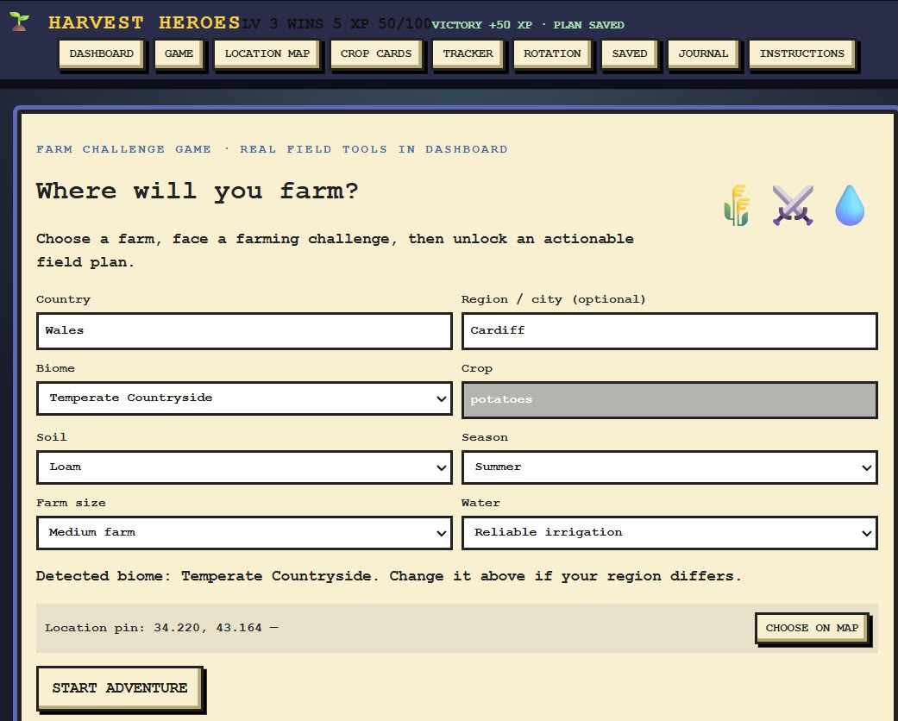
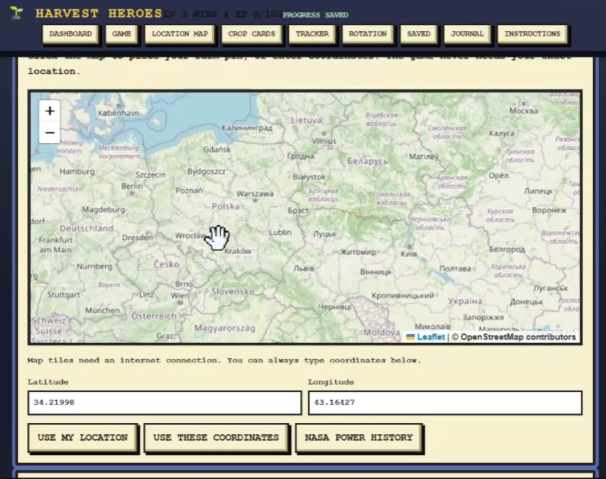
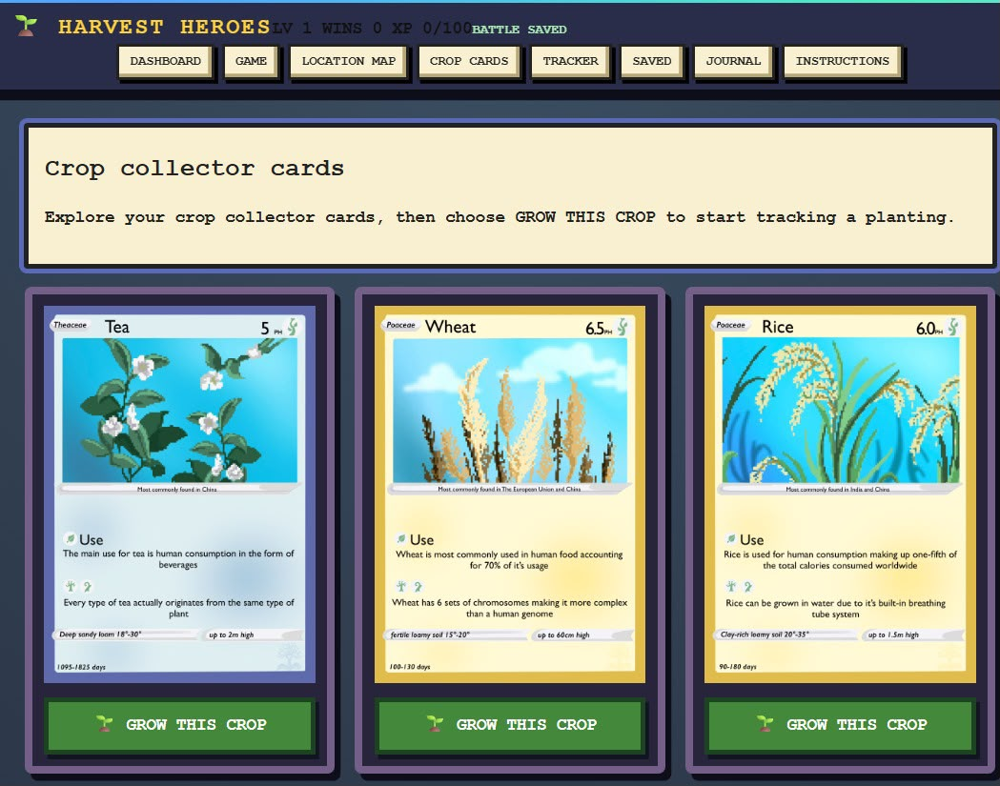
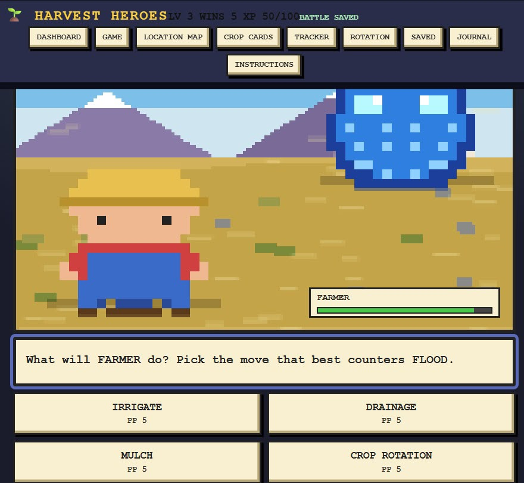

### Team TaterTech

# 🌾 Harvest Heroes: Crop Rotation Recommendation Engine

Built for the NASA Space Apps Challenge "Field Shift: Adapting Farms with
NASA Data."

## 🌍 The problem

Deciding what to plant next season is usually habit and local memory, not
the data that's actually shifting under a field: changing rainfall,
warming seasons, soil quietly depleted by whatever was grown last season.
Most farmers can't easily check that first, because real ground-truth
data (soil moisture, local temperature trends) either doesn't exist for
their field or costs more than a smallholder operation can justify.

Satellite-derived products close that gap. NASA POWER's weather record,
drawn from NASA's own GEOS/MERRA-2 reanalysis models, means almost any
point on the planet already has a usable daily weather and soil-wetness
record, no in-field sensor required. This project uses that directly,
rather than a static regional lookup table, to check whether a crop can
actually grow at a specific site before ever recommending it.

## 🛠️ What we built

A FastAPI backend that, given a farm's location and what the farmer
actually cares about (soil health, water, drought resilience, revenue):

1. Pulls live NASA POWER weather data and ISRIC SoilGrids soil data for
   that exact point, not a regional average, and not a fixed historical
   year: the default date window is a rolling year ending a few days ago,
   genuinely the most recent data available.
2. Checks whether each candidate crop can actually survive the site's
   real temperature pattern across a full year of data, before it's ever
   scored, a crop that can't grow there is dropped, not silently
   recommended.
3. Computes real seasonal water demand with the FAO-56 Penman-Monteith
   method (the global standard used for real irrigation planning),
   verified against FAO-56's own published worked example.
4. Scores every valid 3-year rotation on soil health, water availability,
   drought resilience and revenue, and ranks them by a discounted,
   priority-weighted Rotational Suitability Index (RSI).
5. Returns every rotation with a plain-language explanation, its impact
   versus the farmer's current practice (nitrogen avoided, water saved,
   bare-field days avoided, mapped to relevant UN SDGs), and an explicit,
   unglamorous list of what the model does and doesn't know.

**On honesty**: every design choice that isn't directly literature-backed
is labelled as such, in the code and in the docs, not just in a caveats
section. `docs/algorithm.md` states plainly what's an exact published
method (FAO-56, the nitrogen-fixation direction) versus this project's own
construction (the specific scoring weights, the bare-field-days proxy),
and `docs/validation.md` documents real scoring questions this project's
own cross-checking found and addressed before anyone outside the team saw
them.

## 🎮 The interactive experience

Rather than a static report, the recommendation is presented through a
few interactive pieces built around the engine:



A farm setup screen collects the location, biome, soil, season and other
details for the challenge ahead, with a "choose on map" option rather
than requiring the farmer to type coordinates, and sliders for the
farmer to set their own priority weights (soil health, water, drought
resilience, revenue) that feed directly into the RSI scoring.



That option opens an interactive map, where a farmer can click to drop a
pin or enter coordinates directly, no exact address required.



Every crop in the rotation pool is shown as a trading-card-style display,
for quick, easy browsing of what's available. The crop card art and the
team logo are hand-drawn by [Airan Hughes](#-team), our artist.



An RPG-style minigame lets a farmer play through environmental
challenges (e.g. countering a flood), using the engine's rotation
recommendations to help them win.

## 📚 Docs

- [Algorithm: implementation and references](docs/algorithm.md) — the
  equations, parameter choices, and citations behind every scoring step.
- [Algorithm approach](docs/algorithm-approach.md) — what's built, why,
  and what was deliberately left out.
- [API contract](docs/api-contract.md) — the request/response shape.
- [Validation](docs/validation.md) — the multi-site stress test and the
  comparison against a real long-term Iowa State field study.
- [Deployment](docs/deployment.md) — free, always-on public hosting
  options for judging, and testing the Docker build locally.
- [AI usage](AI_USAGE.md) — where Claude Code was used to build this, and
  where it wasn't.

## 🛰️ NASA data used

**NASA POWER** (Prediction Of Worldwide Energy Resources), daily point
API, global coverage, no API key required. Specific fields pulled:

| Field | What it's used for |
|---|---|
| `T2M`, `T2M_MAX`, `T2M_MIN` | Reference evapotranspiration (FAO-56 Penman-Monteith), climate-suitability check, frost-day check |
| `RH2M` | Relative humidity, for evapotranspiration |
| `WS2M` | Wind speed at 2m, for evapotranspiration |
| `ALLSKY_SFC_SW_DWN` | Surface solar radiation, for evapotranspiration |
| `PRECTOTCORR` | Precipitation, for the water-availability score |
| `GWETROOT`, `GWETTOP` | Root-zone and surface soil wetness, our stand-in for SMAP soil moisture |

Soil wetness (`GWETROOT`/`GWETTOP`) is itself NASA GEOS/MERRA-2 reanalysis
output, not a direct satellite reading, see `docs/algorithm.md` for what
that does and doesn't mean for accuracy.

That's the only live NASA source in the pipeline. SMAP soil moisture and
MODIS/Landsat NDVI were considered and deliberately left out (see
`docs/algorithm-approach.md`), since both need Google Earth Engine setup so not used to prioritise efficiency.

Also used, not a NASA product: ISRIC SoilGrids v2.0 for topsoil texture,
pH and organic carbon.

## 📁 Repo structure

```text
field-shift/
├── README.md
├── AI_USAGE.md
├── CONTRIBUTING.md
├── backend/
│   ├── app/
│   │   ├── main.py            # FastAPI routes (POST /rotations)
│   │   ├── schemas.py         # request/response models, incl. the dynamic date-window default
│   │   ├── engine/            # scoring, climate filtering, candidate generation
│   │   ├── data/               # NASA POWER and SoilGrids API clients
│   │   └── requirements.txt
│   ├── scripts/demo.py        # standalone CLI run, no server needed
│   └── tests/                 # includes a check against FAO-56's own worked example
├── frontend/
├── data/
│   ├── crops.json             # the 10-crop agronomic matrix, every figure cited
│   └── cache/                 # cached API responses, so repeat runs don't re-hit the APIs
└── docs/                      # Detailed documentation of methods and core algorithm
    ├── algorithm.md
    ├── algorithm-approach.md
    ├── api-contract.md
    └── validation.md
```

## 🚀 Getting started: run the website

```bash
cd backend
python3 -m venv .venv && source .venv/bin/activate
pip install -r app/requirements.txt
uvicorn app.main:app --reload
```

Then open **http://localhost:8000/** in a browser. The backend serves the
full Harvest Heroes frontend directly (the map, crop cards, minigame, and
the real NASA-backed recommendation engine all run against this one
server) — nothing else to start.

Note: on Python 3.14, `pydantic`/`pandas` wheels may not be published yet;
use Python 3.12 or 3.13 for the venv if `pip install` tries to compile
from source.

A public, always-on deployment (no local setup needed to see it) is
covered in [docs/deployment.md](docs/deployment.md).

### Backend only, no browser

```bash
cd backend
source .venv/bin/activate
python scripts/demo.py
```

This fetches live NASA POWER and SoilGrids data for a demo farm near
Ames, Iowa, computes FAO-56 reference ET0 and crop water demand, scores
every valid 3-year rotation from `data/crops.json`, and prints the top 5
ranked rotations with their real impact metrics and risk caveats. Try a
different site with `python scripts/demo.py <lat> <lon>`.

With the server running, you can also `POST` to
`http://localhost:8000/rotations` directly — see
[docs/api-contract.md](docs/api-contract.md) for the full request/response
shape.

## ✅ Running the tests

```bash
cd backend
source .venv/bin/activate
pytest
```

57 tests: the scoring engine, the climate-suitability filter, the NASA
POWER and SoilGrids clients (including retry behaviour on a flaky
response and forward-filling a missing trailing value), and a check
against FAO-56's own published worked example (Example 18, within 0.35%),
real-world verification, not just internal consistency.

## 👥 Team

- [Tsuyu Huang](https://github.com/ada-th25): Data and engineering lead
- [Humayra Shah](https://github.com/h18021930): Design and application lead
- [Kajol Mistry](https://github.com/kajolmistry): Research and science lead
- Airan Hughes: Art and design lead

